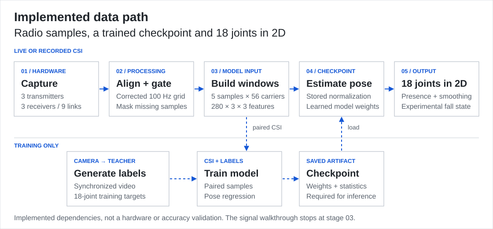

# WiPose

**Follow WiFi measurements from capture to an 18-joint, single-person 2D pose pipeline.**

WiPose connects WiFi channel measurements, or **CSI**, to a research pose pipeline. Full inference needs six ESP32-S3 boards or a compatible recording, plus a trained checkpoint.

**[Run the signal walkthrough ↓](#run-the-signal-walkthrough)** with NumPy and Pillow. No hardware or model needed. [Pipeline and source map](docs/PIPELINE.md) · [Research recording](#recorded-research-demo)

<picture>
  <source media="(max-width: 600px)" srcset="figures/signal-path-mobile.gif">
  
</picture>

**Synthetic samples, executed processing:** 79 of 80 windows pass; the six-packet gap in RX3/TX3 rejects one. Pose inference stays inactive. [Still / reduced motion](figures/signal-path-mobile.png) · [Computation and record](docs/SHOWCASE.md)

## Run the signal walkthrough

**No boards, camera, broker or trained weights.** This local demonstration executes the retained signal-processing routines on synthetic I/Q samples, the two components of each radio sample.

```bash
git clone https://github.com/nazeeh111/WiPose.git
cd WiPose
python -m venv .venv
# macOS / Linux; Windows: .venv\Scripts\activate
source .venv/bin/activate
python -m pip install -r requirements-showcase.txt
python wipose.py showcase
```

Open **`showcase-output/signal-path.gif`**. Expected result: **79 of 80 windows accepted; one rejected** by the deliberately injected missing-data gap. The directory also contains a reduced-motion still and a JSON record of the executed transforms. It needs only NumPy and Pillow; the command makes no network requests or model downloads. Existing output paths are refused. For another run, use `python wipose.py showcase --out another-directory`.

[Desktop still](figures/signal-path.png) · [Narrow-screen still](figures/signal-path-mobile.png) · [Numerical record](figures/signal-path.json) · [Generator](scripts/showcase.py)

## How the pieces connect

<picture>
  <source media="(max-width: 600px)" srcset="figures/pipeline-overview-mobile.svg">
  
</picture>


CSI means **channel state information**: measurements of how a radio channel changes across frequency components. A camera supplies training labels; the trained model's inference input is CSI. [Trace each arrow to its implementation →](docs/PIPELINE.md)

## Choose your next step

- **Understand the implementation:** follow the [training and inference flowcharts](docs/PIPELINE.md), including data shapes, checkpoint requirements and invalid-window behavior.
- **Bring a recording and checkpoint:** use [recorded replay](#replay-your-recorded-session) with a compatible HDF5 session and independently trained model.
- **Build the research setup:** the [operating guide](docs/REFERENCE.md#getting-started) covers six ESP32-S3 boards, firmware, serial links, MQTT, synchronized recording, calibration and teacher labeling.

## Recorded research demo

This retained recording shows the original research project's intended full-system output: estimated 2D pose with an experimental fall-state overlay. It is separate from the synthetic walkthrough above.


**Source-reported recording, not newly replicated here.** Retained from [csi-pose](https://github.com/sel00000/csi-pose/tree/02b1001590beea8e7d6daac57a4d8b4a345eb50f) by Kyung-Bo Kim, Hyun-Seok Jang, So-Hyeon Kim and Gyu-Chae Jung. See the [original setup, staged-fall results and session limits](docs/REFERENCE.md#what-it-detects). The recording is not evidence of accuracy in another room or a validated safety system.

## Replay your recorded session

Use a separate research environment for the [full requirements](requirements.txt), including Torch, camera, recording and teacher dependencies. They are unnecessary for the signal walkthrough. You must supply a compatible recording and checkpoint; this is not a bundled trained-model demo.

```bash
python -m pip install -r requirements.txt
python wipose.py infer --help

python wipose.py infer \
  --replay /path/to/session.h5 \
  --ckpt /path/to/checkpoint.pt \
  --headless --fast --perf-out replay-performance.json
```

The checkpoint supplies model weights, channel convention and normalization statistics. `infer` requires it unless you deliberately choose `--random-weights` for a pipeline smoke check. Random weights provide no meaningful pose estimate. See the [inference contract and source](docs/PIPELINE.md#inference-and-replay).

```bash
python wipose.py train --help
python wipose.py label --help
python wipose.py probe --help
```

These commands pass arguments to the underlying tools. Teacher labeling downloads third-party ONNX models when explicitly run. Follow the [research setup instructions](docs/REFERENCE.md#getting-started) before attempting capture or training.

## Evidence and limits

- **Executed in the presentation work:** deterministic synthetic transforms, injected missing-data rejection, safe output handling, CLI dispatch and bounded kernel comparisons. [Exact checks and environments](docs/VERIFICATION.md).
- **Retained research material:** the recording, figures and source-reported results in the [reference guide](docs/REFERENCE.md). They have not become new measurements through repackaging.
- **Not replicated here:** six-board capture, teacher labeling, full training, trained inference accuracy, cross-session performance and fall-detection accuracy. The system targets one person in 2D. Fall detection is experimental and is not a validated safety or medical system.

After installing the lightweight showcase requirements:

```bash
python -m unittest discover -s tests -v
```

## Source and licensing

WiPose's retained research implementation is based on [csi-pose](https://github.com/sel00000/csi-pose/tree/02b1001590beea8e7d6daac57a4d8b4a345eb50f) by Kyung-Bo Kim, Hyun-Seok Jang, So-Hyeon Kim and Gyu-Chae Jung. CLI, verification and original signal-presentation work is maintained by [nazeeh111](https://github.com/nazeeh111).

[Source details](NOTICE.md) · [Original license](LICENSE) · [New additions](LICENSE-branding) · [Third-party model notices and unresolved redistribution terms](THIRD_PARTY_NOTICES.md)
