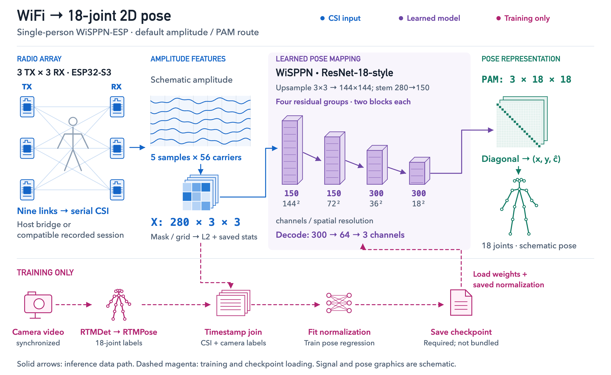
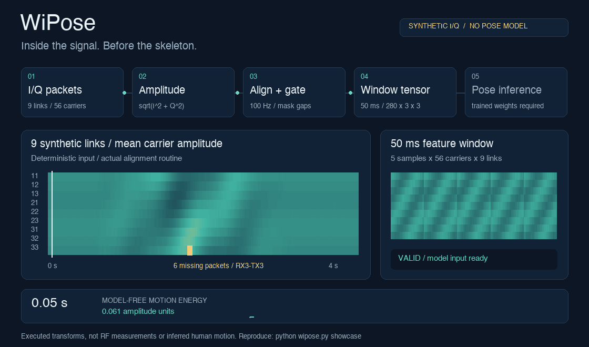

# WiPose

**WiFi CSI → an 18-joint, single-person 2D pose.**

From the [original csi-pose researchers](NOTICE.md): six ESP32-S3 boards, nine **CSI** (channel state information) links, camera-labeled training and model-based pose inference. No trained checkpoint is bundled here.

This fork adds a command facade, source-traced figures and a reproducible **synthetic signal walkthrough**. Six-board capture, training and pose accuracy have not been independently reproduced here. The recorded pose demo remains the original researchers' work.

[Run the synthetic signal walkthrough](#run-the-signal-walkthrough) · [See the original researchers' recorded demo](#recorded-research-demo)

## How the pieces connect

<a href="figures/pipeline-overview.svg">
<picture>
  <source media="(max-width: 600px)" srcset="figures/pipeline-overview-mobile.png">
  
</picture>
</a>

Default amplitude/PAM route; signal textures and pose glyphs are schematic. [Editable figure](scripts/system_figure.py) · [Trace the capture, training and inference code →](docs/PIPELINE.md)

## Pick a route

| You have | Start here |
| --- | --- |
| No hardware or model | [Run the signal walkthrough](#run-the-signal-walkthrough) with NumPy and Pillow |
| A compatible HDF5 recording and trained checkpoint | [Replay a recorded session](#replay-your-recorded-session) |
| Six ESP32-S3 boards | [Capture, synchronize, label and train](docs/REFERENCE.md#getting-started) |

## Get the code

```bash
git clone https://github.com/nazeeh111/WiPose.git
cd WiPose
python -m venv .venv
# macOS / Linux; Windows: .venv\Scripts\activate
source .venv/bin/activate
```

Then install the requirements for your chosen route below.

## Run the signal walkthrough

Try the preprocessing path without boards, camera, broker or trained weights:

```bash
python -m pip install -r requirements-showcase.txt
python wipose.py showcase
```

<picture>
  <source media="(max-width: 600px)" srcset="figures/signal-path-mobile.gif">
  
</picture>

Open **`showcase-output/signal-path.gif`**. The seeded synthetic input yields **79 of 80 accepted windows**; an injected six-packet gap rejects one. This command executes the retained amplitude, alignment, mask, window and motion-energy routines. It makes no network requests or model downloads.

Existing output paths are refused; use `--out another-directory` for another run. [Still / reduced motion](figures/signal-path-mobile.png) · [Numerical record](figures/signal-path.json) · [Computation and reproduction](docs/SHOWCASE.md)

## Recorded research demo


**Original, source-reported recording** from [csi-pose](https://github.com/sel00000/csi-pose/tree/02b1001590beea8e7d6daac57a4d8b4a345eb50f), by Kyung-Bo Kim, Hyun-Seok Jang, So-Hyeon Kim and Gyu-Chae Jung. [Setup and reported results →](docs/REFERENCE.md#what-it-detects)

## Replay your recorded session

Install the [research requirements](requirements.txt) in a separate environment, then supply your recording and checkpoint:

```bash
python -m pip install -r requirements.txt
python wipose.py infer \
  --replay /path/to/session.h5 \
  --ckpt /path/to/checkpoint.pt \
  --headless --fast --perf-out replay-performance.json
```

The checkpoint contains weights, the channel convention and normalization statistics. No trained checkpoint is bundled. `--random-weights` provides a pipeline smoke check, not meaningful pose estimates. [Inference contract](docs/PIPELINE.md#inference-and-replay) · [Inference CLI source](rt/demo.py)

For new recordings, follow the [hardware and training guide](docs/REFERENCE.md#getting-started). `python wipose.py train --help`, `python wipose.py label --help` and `python wipose.py probe --help` expose the underlying tools. Teacher labeling downloads third-party ONNX models when run.

## Evidence and limits

- **Executed here:** deterministic synthetic transforms, missing-data rejection, safe output handling, CLI dispatch and bounded kernel comparisons. [Signal walkthrough CI](https://github.com/nazeeh111/WiPose/actions/workflows/showcase.yml) · [Verification record](docs/VERIFICATION.md). Run `python -m unittest discover -s tests -v` after installing the lightweight showcase requirements.
- **Retained from the original research:** the recording, figures and source-reported results in the [reference guide](docs/REFERENCE.md). Six-board capture, teacher labeling, full training and trained inference have not been replicated in this fork.
- **Scope:** one person in 2D. No cross-session accuracy or fall-safety guarantee. The fall rules are experimental, not a validated safety or medical system. An invalid input window retains the last displayed pose/state, so a visible skeleton can be stale.

## Source and licensing

The research implementation and recording retain the [original authors' attribution](NOTICE.md). CLI, verification and the reproducible signal walkthrough are maintained by [nazeeh111](https://github.com/nazeeh111).

[Original license](LICENSE) · [New additions](LICENSE-branding) · [Third-party model notices](THIRD_PARTY_NOTICES.md)
