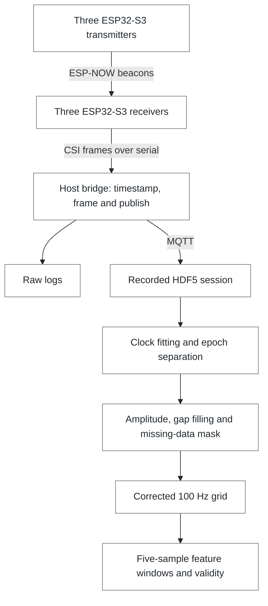
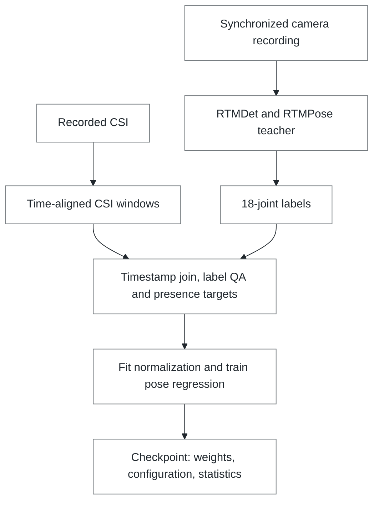
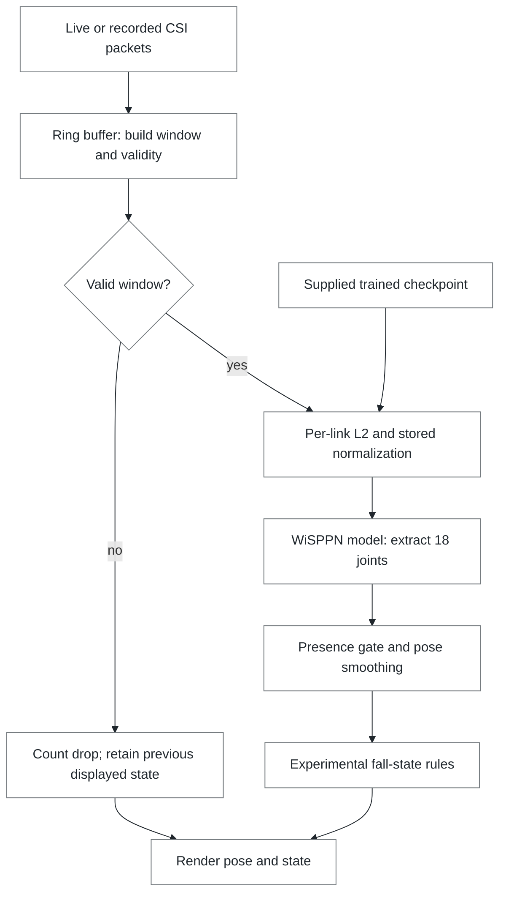

# Follow the WiPose pipeline

The overview describes implemented dependencies. It does not establish successful hardware operation or pose accuracy. The [verification record](VERIFICATION.md) separates executed checks from retained research results.

[Runnable walkthrough](../README.md#run-the-signal-walkthrough) · [Hardware setup](REFERENCE.md#hardware-requirements) · [Research reference](REFERENCE.md)

## Capture and sample construction

The default amplitude route combines **five time samples × 56 carriers × nine radio links** into a `float16` tensor shaped **`(280, 3, 3)`**. The last two axes index receiver and transmitter. A short sequence gap of at most two samples can be interpolated, and its provenance stays in the mask. Longer gaps remain breaks. The window gate rejects a window when any link has at least two masked slots among its five samples. The synthetic walkthrough deliberately exercises a six-packet gap.

The guide shows the offline sample path. Live inference uses its own [ring buffer](../rt/csi_rt/ringbuf.py) to cut windows, while [replay sources](../rt/csi_rt/sources.py) read the recorded link data. These paths share an input contract, not one identical execution graph.

| Boundary | Source |
| --- | --- |
| Radio capture and serial frames | [TX firmware](../firmware/tx/main/main.c), [RX firmware](../firmware/rx/main/main.c) |
| Host timestamps, framing, raw log and MQTT | [host bridge](../host/bridge/bridge.py), [bridge core](../host/csi_host/bridge_core.py) |
| Session recording | [recorder](../host/recorder/recorder.py) |
| Clock correction | [clock fitting](../host/csi_pipe/clockfit.py) |
| Epochs, amplitudes, gap mask, grid and windows | [alignment routines](../host/csi_pipe/align.py), [sample builder](../host/csi_pipe/samples.py) |
| Synthetic data through actual routines | [showcase generator](../scripts/showcase.py) |

## Training: where the checkpoint comes from

The camera is a training-label source. It does not turn the no-hardware walkthrough into a pose demonstration. Teacher labeling runs third-party ONNX models and can download those models when invoked. Label generation, pairing and training need appropriate recordings and configuration; the README does not supply a trained checkpoint.

The model maps CSI features into a pose representation. Its default pose adjacency matrix (PAM) has shape `(3, 18, 18)`; inference extracts the diagonal to obtain 18 joint coordinates and a per-joint confidence channel. An optional vector head outputs `(3, 18)` directly. The confidence channel is a model output, not a calibrated probability of correctness.

| Operation | Source |
| --- | --- |
| Camera teacher and ONNX dependencies | [runner](../teacher/csi_teacher/runner.py) |
| Label construction | [labels](../teacher/csi_teacher/labels.py), [18-joint mapping](../teacher/csi_teacher/body18.py) |
| Window storage | [sample builder](../host/csi_pipe/samples.py) |
| Timestamp join, label QA and presence targets | [pose target builder](../teacher/csi_teacher/pam.py) |
| Normalization and channel convention | [training data](../train/csi_train/data.py) |
| Model and alternate heads | [model](../train/csi_train/model.py) |
| Fitting and checkpoint persistence | [training loop](../train/csi_train/fit.py) |

## Inference and replay

[PoseEstimator](../rt/csi_rt/infer.py) loads the checkpoint, checks the channel convention, applies per-link L2 normalization followed by the saved mean and scale, and runs the model. Its coordinate output is `(18, 2)`, with a separate `(18,)` confidence array. A camera is not required as model input; optional synchronized video can be used as the display background.

[Engine.tick](../rt/demo.py) runs the estimator only on a valid window. It applies the [presence gate](../rt/csi_rt/presence.py), [smoother](../rt/csi_rt/smooth.py) and [fall rules](../rt/csi_rt/fall.py). On an invalid window it increments the drop counter and retains the previous displayed pose/state. A visible skeleton can therefore be stale; it is not evidence that every window yielded a new estimate. Motion energy is a separate model-free variability measure used by the fall rules and display; it is not itself a pose or human-presence estimate.

The scheduled window boundary is 50 ms. That describes the pipeline's time grid, not verified live throughput on your hardware. The headless replay command writes a performance summary for the run actually executed. `--random-weights` is explicitly a smoke-test route, not trained inference.

## Reading the demonstrations

The [signal walkthrough](SHOWCASE.md) runs the real amplitude, alignment, mask, window and motion-energy functions on deterministic synthetic samples. Its diagrammed model stage stays inactive. The [original research recording](REFERENCE.md#what-it-detects) shows a separate source-reported full-system run. Neither the overview nor the new documentation adds hardware validation, cross-room accuracy or a fall-safety guarantee.

The original overview artwork is generated by `python scripts/presentation.py`, using only the standard library. Edit that generator and regenerate both desktop and narrow-screen SVGs together. The flowcharts above use Mermaid, GitHub's text-based diagram renderer. Keep their nodes and arrows tied to the linked code when the implementation changes.
